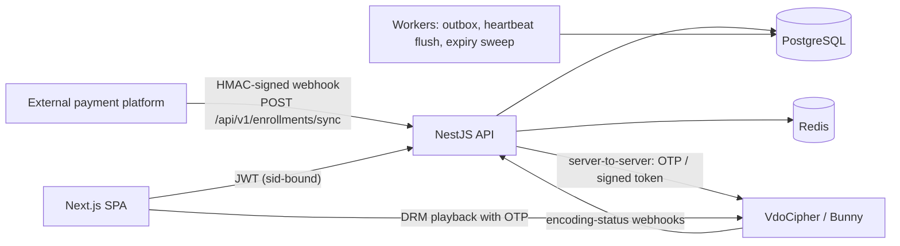
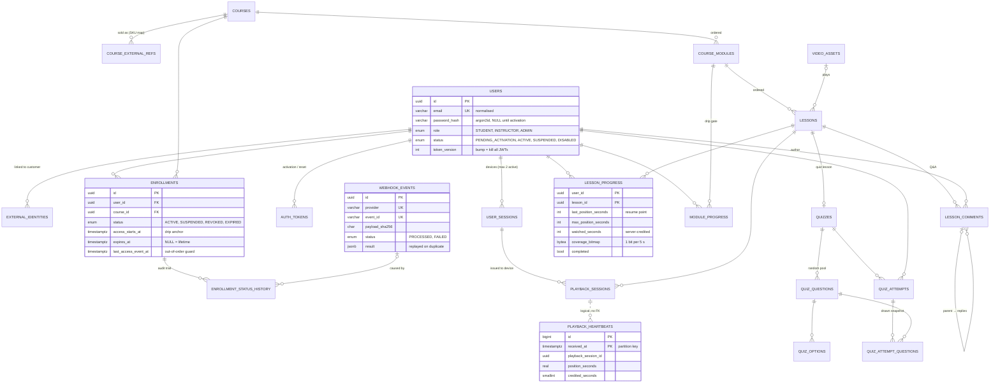
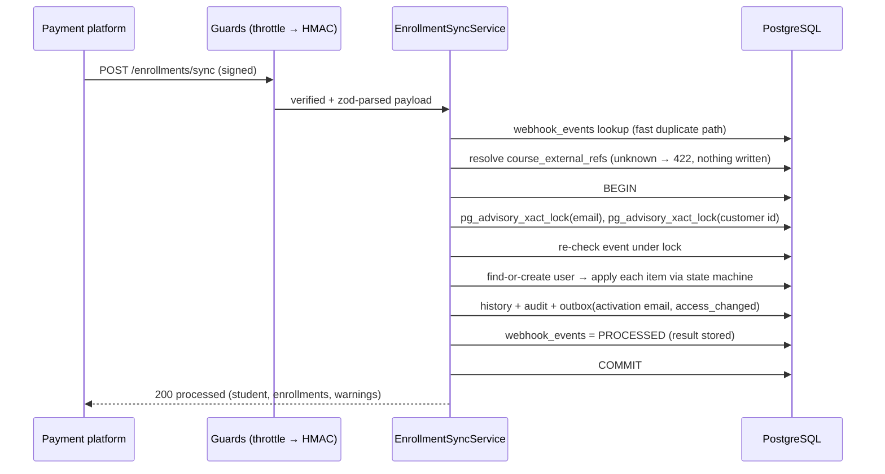
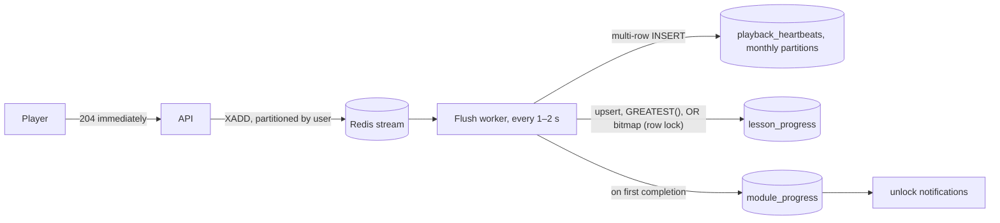

# LMS for Recorded Classes — Architecture

Secure content delivery, student management and admin tracking. **Out of scope:** payments, storefront, checkout. Those run on the external payment platform, which reaches the LMS only through signed webhooks.

| Layer | Choice | Why |
|---|---|---|
| API | **NestJS 12 + TypeScript (ESM)** | Modules, guards and pipes map directly onto clean-architecture boundaries |
| ORM / DB | **Prisma 7 + PostgreSQL 15+** | Relational integrity for access rights, advisory locks, range partitioning for analytics |
| Validation | **Zod 4** | Strict parsing at every trust boundary; types are inferred from the schemas |
| Cache / queues | Redis (planned) | Session revocation set, heartbeat buffer, rate limits |
| Video | **VdoCipher** (preferred) or **Bunny Stream** behind one `VideoProvider` port | DRM, short-lived playback credentials, server-side watermark (VdoCipher) |
| Frontend | Next.js App Router + Tailwind (separate `frontend/` app) | — |



---

## 1. Database schema / ERD

- **Source of truth:** [`backend/prisma/schema.prisma`](../backend/prisma/schema.prisma), 24 tables, all documented inline.
- **Generated SQL DDL:** [`backend/prisma/migrations/20261105081949_init/migration.sql`](../backend/prisma/migrations/20261105081949_init/migration.sql). It was hand-edited only to range-partition `playback_heartbeats` by month. Prisma reports **no drift** after the edit; this was verified with `prisma migrate diff`.



**Design notes**

- **UUIDv7 keys.** They are time-ordered (B-tree friendly) and can't be guessed or enumerated.
- **The payment platform never sees internal IDs.** `course_external_refs` maps its product IDs to courses, and `external_identities` maps its customer IDs to users.
- **Hot state vs. raw logs.** `lesson_progress` is one small row per student per lesson that the player resumes from. `playback_heartbeats` is append-only, partitioned, has no foreign keys, and is cheap to `DROP PARTITION` after retention.
- **`module_progress` is materialised,** so the drip check is a primary-key lookup instead of an aggregate over all lessons.
- **Every access change is auditable.** It is recorded in `enrollment_status_history` (from → to, reason, webhook event or admin actor) and in `audit_logs` for admin tracking.

---

## 2. Backend folder hierarchy

✅ = implemented in this repo, the rest is the planned layout. The dependency direction is strictly `modules → domain`, and `modules → infrastructure` through ports. Domain code imports no framework.

```
backend/
├── prisma/
│   ├── schema.prisma                          ✅ full data model
│   └── migrations/20261105081949_init/        ✅ SQL DDL (+ heartbeat partitioning)
├── prisma.config.ts                           ✅
├── scripts/
│   ├── send-test-webhook.mjs                  ✅ reference signer for the payment team
│   └── sample-enrollment-event.json           ✅
├── src/
│   ├── main.ts                                ✅ bootstrap (rawBody on)
│   ├── app.module.ts                          ✅
│   ├── app.setup.ts                           ✅ HTTP pipeline shared with e2e tests
│   ├── config/                                ✅ zod-validated env, fails fast
│   ├── common/
│   │   ├── security/webhook-signature.ts      ✅ HMAC + timestamp, constant-time compare
│   │   ├── pipes/zod-validation.pipe.ts       ✅
│   │   ├── guards/                            jwt-auth.guard, roles.guard, enrollment-access.guard
│   │   ├── decorators/                        @CurrentUser, @Roles, @Public
│   │   └── filters/                           problem-details exception filter
│   ├── infrastructure/
│   │   ├── prisma/                            ✅ PrismaService (pg driver adapter)
│   │   ├── redis/                             session set, heartbeat stream, throttler storage
│   │   ├── video/                             video-provider.port.ts, vdocipher.adapter.ts, bunny.adapter.ts
│   │   ├── mail/                              mailer.port.ts + SES/Postmark adapter
│   │   └── outbox/                            outbox relay worker
│   ├── modules/
│   │   ├── enrollments/
│   │   │   ├── domain/access-transition.ts    ✅ pure state machine (+ spec)
│   │   │   ├── sync/                          ✅ webhook controller / guard / schema / service / errors
│   │   │   ├── admin/                         manual suspend / revoke / extend, replay FAILED events
│   │   │   └── enrollments.module.ts          ✅
│   │   ├── auth/                              login, refresh rotation, activation, device-limit service
│   │   ├── users/                             profile, admin student management
│   │   ├── catalog/                           courses → modules → lessons (read side)
│   │   ├── access/                            curriculum-access.policy.ts (drip + quiz gates)
│   │   ├── playback/                          playback credentials, watermark payload
│   │   ├── progress/                          heartbeat ingest, progress roll-up
│   │   ├── quizzes/                           attempt start (random draw), submit (grading)
│   │   ├── discussions/                       lesson Q&A threads, moderation
│   │   ├── video-webhooks/                    VdoCipher/Bunny encoding status → video_assets
│   │   └── admin-reports/                     watch-time, completion, suspicious-activity reports
│   ├── jobs/                                  expiry sweeper, heartbeat partition maintenance
│   └── generated/prisma/                      (generated, git-ignored)
└── test/
    └── enrollment-sync.e2e-spec.ts            ✅ 15 tests against a real PostgreSQL
```

---

## 3. `POST /api/v1/enrollments/sync`, the enrollment webhook

**Code:** [`enrollment-sync.controller.ts`](../backend/src/modules/enrollments/sync/enrollment-sync.controller.ts), [`enrollment-webhook.guard.ts`](../backend/src/modules/enrollments/sync/enrollment-webhook.guard.ts), [`enrollment-sync.schema.ts`](../backend/src/modules/enrollments/sync/enrollment-sync.schema.ts), [`enrollment-sync.service.ts`](../backend/src/modules/enrollments/sync/enrollment-sync.service.ts) and [`access-transition.ts`](../backend/src/modules/enrollments/domain/access-transition.ts).

### 3.1 Handshake: API key ID + shared secret (HMAC-SHA256)

| Header | Value |
|---|---|
| `X-LMS-Key-Id` | Public key ID that selects the shared secret. Several can be active, which allows zero-downtime rotation. |
| `X-LMS-Timestamp` | Unix seconds at signing time. Requests outside ±300 s are rejected. |
| `X-LMS-Signature` | `v1=` + `hex(HMAC_SHA256(secret, "<timestamp>.<raw body>"))` |

Server config: `ENROLLMENT_WEBHOOK_KEYS="key_2026a:<≥32-char secret>,key_2026b:<secret>"`.

The secret never travels over the wire. The timestamp is part of the MAC, so an old signature can't be re-stamped. Signatures are compared in constant time. The guard runs **before** body validation, and every failure returns the same generic 401; the specific reason is only logged.

### 3.2 Payload

```json
{
  "event_id": "evt_01JC9W6Q3M",
  "occurred_at": "2026-11-05T09:30:00Z",
  "student": { "external_id": "cus_8812", "email": "jane@example.com", "full_name": "Jane Doe", "phone": "+15550100" },
  "enrollments": [
    { "action": "GRANT",   "course_id": "prod_react", "expires_at": "2027-11-05T00:00:00Z", "order_id": "ord_771", "reason": "PURCHASE" },
    { "action": "SUSPEND", "course_id": "prod_vue",   "reason": "CHARGEBACK" },
    { "action": "REVOKE",  "course_id": "prod_node",  "reason": "REFUND", "order_id": "ord_640" }
  ]
}
```

- **`GRANT`** creates the enrollment, or re-activates or updates it. `expires_at` is required: `null` means lifetime access, and a new GRANT extends or shortens access.
- **`SUSPEND`** is a reversible hold. It never downgrades a `REVOKED` enrollment.
- **`REVOKE`** handles refunds and lost chargebacks. Only a newer GRANT re-opens access.
- **Validation is strict.** Unknown keys are rejected (so nobody can send `role: "ADMIN"`), each course may appear only once per event, and timestamps must carry a timezone.

### 3.3 Processing guarantees



| Concern | Mechanism |
|---|---|
| Duplicates / retries | `(provider, event_id)` unique ledger. A re-delivery gets the stored result back with `status: "duplicate"`. The same `event_id` with a different payload returns **409**. The fingerprint is taken over the *parsed* payload, so re-serialisation by the sender is harmless. |
| Concurrency | Transaction-scoped advisory locks on email and customer ID, taken in sorted order (no deadlocks). Tested: 6 parallel identical deliveries are applied once, and 2 parallel events for a brand-new student create one account. |
| Atomicity | User, enrollments, history, audit, outbox and ledger commit together. A failure leaves a `FAILED` ledger row for replay, never partial state. |
| Out-of-order delivery | `enrollments.last_access_event_at`: an event older than the newest applied change is `STALE_IGNORED`. A REVOKE for a course the student never had creates a tombstone, so a late GRANT can't resurrect access. |
| Account safety | Webhook-created accounts are `STUDENT` and `PENDING_ACTIVATION` with **no password**; the student sets one through an emailed one-time link (outbox → worker). The login email is never changed from the storefront (`EMAIL_CHANGE_IGNORED` warning). The webhook never links to INSTRUCTOR/ADMIN accounts (422). |

**Responses and the sender's retry policy**

| Code | Meaning | Sender should |
|---|---|---|
| 200 | Applied, or a duplicate of an applied event | Stop |
| 400 / 401 / 415 | Malformed or unauthenticated | Fix, don't retry |
| 409 | `event_id` reused with a different payload | Don't retry |
| 422 | Unknown course mapping or identity conflict | Retry after an admin fixes the data |
| 429 / 503 / 500 | Transient | Retry with exponential backoff |

Reference signer: `WEBHOOK_KEY_ID=.. WEBHOOK_SECRET=.. node scripts/send-test-webhook.mjs payload.json`

---

## 4. Authentication and the 2-device limit

- **Access token:** a JWT, 10 min, ES256, claims `{ sub, sid, role, tv }`. `sid` is a `user_sessions.id` and `tv` is `users.token_version`.
- **Refresh token:** opaque 256-bit, stored as SHA-256, **rotated on every use**, sent as an httpOnly `SameSite=Strict` cookie. If an already-rotated token is presented again, the whole `token_family_id` is revoked (`REFRESH_TOKEN_REUSE`).
- **Passwords:** argon2id. Login is rate-limited per IP and per account, and the error is the same whether or not the account exists.

**Device limit, enforced on login:**

```sql
BEGIN;
SELECT pg_advisory_xact_lock(hashtextextended('sessions:' || $user_id, 0));   -- no login races
UPDATE user_sessions SET revoked_at = now(), revoke_reason = 'DEVICE_LIMIT'
 WHERE id IN (
   SELECT id FROM user_sessions
    WHERE user_id = $user_id AND revoked_at IS NULL AND expires_at > now()
    ORDER BY last_seen_at DESC
   OFFSET 1                                   -- keep the newest 1; the new login makes 2
 );
INSERT INTO user_sessions (...) VALUES (...);
COMMIT;
```

Revocation takes effect immediately. The JWT guard checks `sid` against a Redis set of active sessions (written through on login and revoke, with a DB fallback). The playback-credential and heartbeat endpoints always check, so an evicted device can't start a new video, and its running player is stopped on its next heartbeat (401 → the player is destroyed).

---

## 5. Content protection

### 5.1 Short-lived playback credentials

`POST /api/v1/lessons/:lessonId/playback` (JWT) runs these checks, in order:

1. The session (`sid`) is active and the user status is `ACTIVE`.
2. The enrollment `hasActiveAccess` (status `ACTIVE` and not expired).
3. The access policy (§7) unlocks the module and lesson.
4. The rate limit allows it (≤ N credentials per user per 10 min, which blocks scripted bulk download).
5. It creates a `playback_sessions` row with a random 8-char `watermark_code`.
6. It requests the credential **server-to-server** and returns it with the `playbackSessionId`:
   - **VdoCipher:** `POST /api/videos/{id}/otp` with `Authorization: Apisecret …`, `ttl: 300`, and an `annotate` (watermark) spec. It returns `{ otp, playbackInfo }`. Widevine/FairPlay DRM means a stolen OTP can't be replayed outside the licensed player.
   - **Bunny Stream:** an embed token `sha256(tokenSecurityKey + videoId + expires)` with `expires = now + 300`, plus referrer allow-listing and MediaCage DRM if enabled.

The API secret for the video host lives only on the server. The client never receives a permanent URL.

### 5.2 Dynamic watermarking

The watermark payload is assembled on the server and is never taken from client input:

```
"{email-masked} · {user_id[0:8]} · {client IP} · {issued_at UTC} · #{watermark_code}"
```

- **VdoCipher (preferred):** the text goes into the OTP's `annotate` parameter as a moving `rtext` (random position every ~5 s, ~0.3–0.5 alpha). It is rendered **inside the DRM player**, so it can't be removed with dev tools and it appears in screen recordings.
- **Bunny Stream:** there's no per-viewer server-side text, so the SPA renders an overlay `<canvas>` above the iframe. It repositions randomly and its opacity varies. A `MutationObserver` re-mounts it if removed, and each heartbeat reports `overlay_ok`; missing overlays flag the session for review. This is a **deterrent, not a guarantee.** Use VdoCipher, or Bunny with forensic watermarking, for high-value courses.
- **Forensics:** a leaked recording shows `#watermark_code`, which maps to a `playback_sessions` row (user, device, IP, time). An admin can then suspend the account (`users.status = SUSPENDED` and `token_version++`).

---

## 6. Watch analytics and progress engine

**Ping contract:** `POST /api/v1/playback/:playbackSessionId/heartbeats`, every 5–10 s while playing, plus on pause, seek and `ended`.

```json
{ "seq": 42, "position": 734.2, "rate": 1.0, "playing": true, "completed": false, "client_ts": "2026-11-05T10:00:05.120Z" }
```

**Server-side validation (the client is never trusted):**

- The playback session must belong to the caller's `sid`, must not be ended, and its `last_heartbeat_at` must be under 60 s old.
- `seq` must increase strictly (replays are dropped).
- `credited = clamp(position − prev_position, 0, (now − last_heartbeat_at) × min(rate, 2) + 2 s)`. Seeking forward earns nothing; 16× playback earns at most 2×.
- Coverage bits are set only for the continuously watched span `[prev_position, position]`.
- **Completion** means coverage ≥ `lessons.completion_threshold` (default 90 %). Scrubbing to the end does not complete a lesson, and the client's `completed: true` is only a hint.

**Write path (scales to ~1–2 k pings/s per node):**



```sql
INSERT INTO lesson_progress (user_id, lesson_id, last_position_seconds, max_position_seconds, watched_seconds, coverage_bitmap)
VALUES ($1, $2, $3, $4, $5, $6)
ON CONFLICT (user_id, lesson_id) DO UPDATE SET
  last_position_seconds = EXCLUDED.last_position_seconds,
  max_position_seconds  = GREATEST(lesson_progress.max_position_seconds, EXCLUDED.max_position_seconds),
  watched_seconds       = lesson_progress.watched_seconds + EXCLUDED.watched_seconds,
  coverage_bitmap       = EXCLUDED.coverage_bitmap,   -- merged in the worker under the per-user ordering
  last_watched_at       = now();
```

At smaller scale the worker can be skipped: the endpoint writes directly with the same SQL. Partition upkeep runs daily: `SELECT ensure_playback_heartbeat_partitions(2);` (created by the init migration). Old partitions are rolled up into reports and dropped.

---

## 7. Content dripping and gating (access policy)

**The rule.** Module *X* is open when **any** of these holds:

- *X* is the first module;
- module *X−1* is completed (`module_progress.completed_at IS NOT NULL`);
- `now ≥ enrollment.access_starts_at + module.unlock_after_days` (only when the column is set).

**The quiz blockade on top of that.** A lesson is open only if its module is open **and** no quiz before it in the course is still unpassed. Time-based drip never bypasses a failed quiz.

```ts
// modules/access/curriculum-access.policy.ts — pure, unit-testable
export function moduleUnlockState(m: { position: number; unlockAfterDays: number | null },
                                  prevCompletedAt: Date | null, accessStartsAt: Date, now: Date) {
  if (m.position === 1 || prevCompletedAt) return { unlocked: true } as const;
  if (m.unlockAfterDays !== null) {
    const unlockAt = new Date(accessStartsAt.getTime() + m.unlockAfterDays * 86_400_000);
    return now >= unlockAt ? { unlocked: true } as const : { unlocked: false, unlockAt } as const;
  }
  return { unlocked: false, reason: 'PREVIOUS_MODULE_INCOMPLETE' } as const;
}
```

```sql
-- Blocking quiz anywhere before (module_pos, lesson_pos)? One indexed query.
SELECT l.id
  FROM lessons l
  JOIN course_modules m ON m.id = l.module_id
  JOIN quizzes q        ON q.lesson_id = l.id
 WHERE m.course_id = $course_id
   AND (m.position, l.position) < ($module_pos, $lesson_pos)
   AND NOT EXISTS (SELECT 1 FROM quiz_attempts a
                    WHERE a.quiz_id = q.id AND a.user_id = $user_id AND a.passed)
 LIMIT 1;
```

The policy is enforced **on the server, on every content path**: the curriculum listing returns `locked`/`unlock_at` per item, the playback endpoint returns `403 MODULE_LOCKED` / `QUIZ_REQUIRED`, and article content and quiz start do the same. The UI only reflects the decision.

---

## 8. Interactive elements

### 8.1 Quizzes: randomised and strictly gated

- **Start an attempt** (`POST /quizzes/:id/attempts`). The server checks lesson access, `max_attempts` and `retry_cooldown_minutes`. It draws `questions_per_attempt` random active questions from the pool and shuffles their options. The drawn set is **snapshotted** in `quiz_attempt_questions`, so a reload doesn't re-roll and grading uses exactly what was shown. `expires_at = now + time_limit`. The response never contains `is_correct`.
- **Submit.** The attempt is graded on the server inside one transaction. SINGLE_CHOICE needs an exact match; MULTIPLE_CHOICE needs an exact set match (all-or-nothing by default). `score_percent = awarded / possible × 100` and `passed = score ≥ passing_score_percent` (default **70**). A late submit returns `EXPIRED`.
- **Gate.** A passing attempt marks the quiz lesson `completed` and recomputes `module_progress` in the same transaction. Below 70 %, every later lesson stays locked (§7).
- **Anti-cheat.** Correct answers are revealed only after a pass, or after attempts run out, depending on configuration. Attempts are rate-limited. A unique `(quiz_id, user_id, attempt_number)` stops double-submits.

### 8.2 Lesson Q&A threads

- `depth` 0 is a question, 1 an answer, 2 a reply (max depth enforced). `root_id` loads a whole thread with one indexed query: `WHERE root_id = $q OR id = $q ORDER BY created_at`.
- **List questions** with `WHERE lesson_id = $1 AND parent_id IS NULL AND status = 'VISIBLE' ORDER BY is_pinned DESC, created_at DESC`, keyset-paginated.
- **Posting rules.** Posting requires active access to the lesson's course. `root_id = parent.root_id ?? parent.id` and `root.reply_count++` happen in the same transaction. Bodies are Markdown, sanitised when rendered. Posts are rate-limited. Instructors can pin, resolve, accept an answer or hide a post. Author deletes are soft (`DELETED`), so threads stay intact.

---

## 9. Security checklist

- [x] Webhook: HMAC with key rotation, timestamp tolerance, constant-time compare, raw-body signing, generic errors, 256 KB body cap, throttling, idempotency ledger, strict schema
- [x] Least-privilege provisioning: no passwords or roles via webhook, staff accounts never auto-linked, no email changes from the storefront
- [x] Every access change is audited (`enrollment_status_history`, `audit_logs`)
- [x] Fail-fast configuration: weak or missing secrets stop the boot
- [ ] JWT + session revocation set, argon2id, login throttling (§4)
- [ ] Playback credentials only after the access-policy check, with short TTLs (§5)
- [ ] Server-validated heartbeats and coverage-based completion (§6)
- [x] `helmet` security headers and `x-powered-by` removal on the API
- [ ] CORS allow-list for the SPA origin, CSP on the frontend
- [ ] Secrets in a secrets manager (not `.env`) in production; DB role without DDL rights for the app

## 10. Running locally

```bash
cd backend
cp .env.example .env            # set DATABASE_URL and ENROLLMENT_WEBHOOK_KEYS
npm install
npx prisma migrate deploy
npm run build && npm start      # → POST http://localhost:3000/api/v1/enrollments/sync
TEST_DATABASE_URL=postgresql://.../lms_test npm test   # unit + e2e (e2e skipped without the URL)
```
